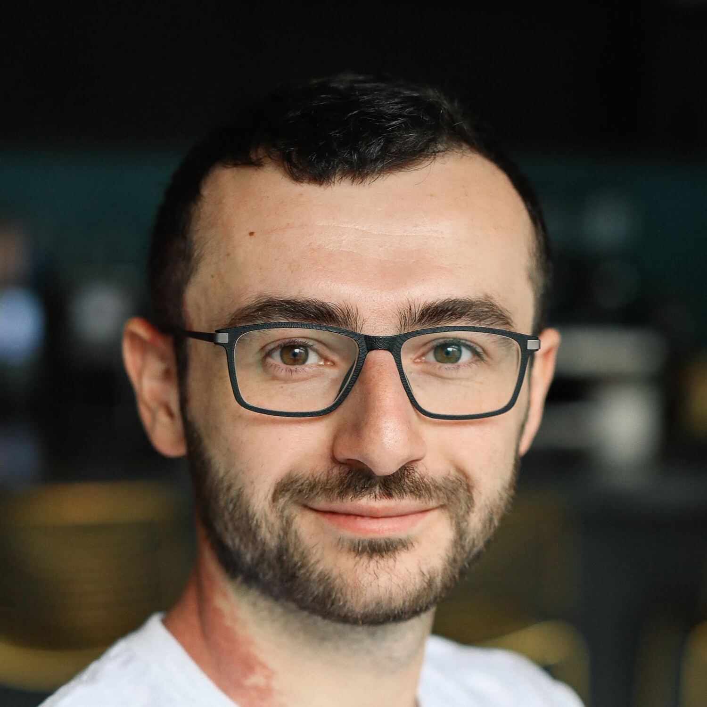

##  About Me

I am an **MSc. student** in Computer Science at [ETH Zurich](https://ethz.ch), currently a **Visiting Student Researcher** at [Stanford University](https://www.stanford.edu/) in the [Gradient Spaces Lab](https://gradientspaces.stanford.edu/), supervised by [Prof. Iro Armeni](https://ir0.github.io/). Before that I was a **Research Assistant** at the [ETH AI Center](https://ai.ethz.ch/), working on [Apertus](https://arxiv.org/abs/2509.14233) with [Dr. Imanol Schlag](https://ischlag.github.io/).

  
  
  

---

##  Education

1. **Master's in Computer Science**. ETH Zurich. Zurich, Switzerland. Sep. 2025 - Present  
GPA 5.4/6. Coursework: Computer Vision, Large-Scale AI Engineering, 3D Vision, Probabilistic AI, LLM, Computational Intelligence, Advanced Systems (FastCode).
2. **Visiting Student Researcher**. Stanford University. Stanford, CA, USA. Jun. 2026 - Present
3. **Bachelor's in Computer Engineering**. Politecnico di Torino. Turin, Italy. Oct. 2022 - Jun. 2025  
110 cum laude/110. Top 10 on the entrance exam, full scholarship. Member of Collegio Einaudi (merit-based college) and QubiTo (quantum computing student team).
4. **Visiting Student**. EPFL. Lausanne, Switzerland. Aug. 2024 - Dec. 2024
5. **AI Summer School Participant**. Texas A&M @Qatar. Doha, Qatar. May. 2024 - Jun. 2024

---
##  Experience

1. **Student Researcher**. [Gradient Spaces Lab](https://gradientspaces.stanford.edu/), Stanford University. Jun 2026 – Current.  
Developing an efficient, motion-coherent video generative model leveraging codec-native tokenization.
2. **Research Assistant**. [Apertus.ai](https://arxiv.org/abs/2509.14233), [ETH AI Center](https://ai.ethz.ch/). Zurich, Switzerland. Jul 2025 – Jul 2026.  
Built *vrl*, a vision RL pipeline for tool use in Apertus, focused on zoom-in and grounding capabilities. Developed *reval*, a lightweight reasoning evaluation pipeline used to track Apertus during RL training. Implemented stochastic rounding for FP8 in torchao to support low-precision training.
3. **Research Intern**. [LiGHT Lab](https://www.light-laboratory.org/), Yale & EPFL. Aug 2024 – Dec 2024.  
Developed a compact, uncertainty-aware CNN with a 3x performance gain over previous models, and designed the data engine of the project supporting Doctors Without Borders.
4. **Research Assistant**. [Fabris Lab](https://fabrislab.com/), Polytechnic of Turin. Sep 2023 – Jul 2024.  
Developed the *starMeter* package and processed Raman spectroscopy signals for material characterization.

---

##  Papers
1. **Co-first author**. *SpaceFlow - Part-Wise Spatial and Appearance Guidance for 3D Generation*. M. Sayfiddinov, N. De La Fuente, J. Lafuente, F. Scharitzer. Jun 2026

2. **Contributor**. *[Apertus - Democratizing Open and Compliant LLMs for Global Language Environments](https://arxiv.org/abs/2509.14233)*. A. Bosselut, M. Jaggi, I. Schlag et al. Sep 2025

---

##  Projects
1. **[vrl](https://github.com/AlignedDragon/Vision-RL-Apertus)**. Vision RL pipeline for Apertus agentic tool use.  
2. **[antibiogo](https://github.com/AlignedDragon/antibiogo)**. Uncertainty-aware CNN model to automate antibacterial resistance tests in low-resource settings.  
3. **[VJEDAI](https://github.com/AlignedDragon/VJEDAI)**. Video-native monocular depth estimation model with V-JEPA priors.  
4. **[gatr.cpp](https://github.com/AlignedDragon/gatr.cpp)**. CPU-optimized variant of the geometric algebra transformer.  
5. **[reval](https://github.com/AlignedDragon/reasoning-eval-apertus)**. Light-weight reasoning evaluation pipeline for Apertus post-training.  
6. **[FP8](https://github.com/AlignedDragon/ao)**. Stochastic rounding implementation for FP8 in torchao.  
7. **[starMeter](https://github.com/AlignedDragon/starMeter)**. Package with classical and DL vision tools to automate quantitative analysis of nanomaterials.  
8. **[course_projects](https://github.com/AlignedDragon?tab=repositories)**. Course projects for bachelor and master courses taken.  

*Languages*: Python, Java, C, SQL, MATLAB. *Tools*: PyTorch, TensorFlow, Git.

---

##  Independent Learning
1. **[Startup School](https://www.startupschool.org/)**. Y Combinator

2. **[Machine Learning](https://coursera.org/verify/specialization/EQK94P2236NR)**. Stanford Online

3. **[Data Science](https://drive.google.com/drive/folders/1GaDuIVe9gUTxDT-hVQuBrO8uhJqlO5_H?usp=drive_link)**. Kaggle

4. **[Applied Probability](https://drive.google.com/file/d/13lU3xfmI12Z88l9tEWb4w-F8dSRaVrkd/view?usp=sharing%20-)**. MIT OpenCourseWare

5. **[Linear Algebra](https://drive.google.com/file/d/1Ibgi8zKDHEeeuuIBBeV1oObm8PBLoPdq/view?usp=sharing)**. MIT OpenCourseWare

6. **[Entrepreneurship](https://coursera.org/verify/specialization/75F3XIG0IMUF)**. University of Pennsylvania

7. **[Intro to Quantum Computing](https://drive.google.com/file/d/1XlsxQS0pzdEUZvcIVNEF4eA2m0XKp4Ij/view?usp=sharing)**. Google Quantum AI & QxQ

---

##  External Activities
1. **Educational Advisor**. Volunteer at [StudentHelp](https://t.me/StudentHelpItaly) for Central Asian students transitioning to European universities.

2. **Self-made philosopher**. Love reading thought-intensive books and keep a [blog](https://t.me/inshorter) for my thoughts.

3. **Language learner**. English (C2 [IELTS 8.0](https://drive.google.com/file/d/187g0toTuzfwWyZoiEZ4tScRzL2aY58Nq/view?usp=sharing)), Russian (C1+), Italian (B1). Currently learning Turkish (A1) and Arabic (A1).

4. **Sports enthusiast**. Gym, running, ping pong.

---

##  News
<table>
  <tr>
    <td>Jun. 2026</td>
    <td>Started as a Student Researcher at Stanford's Gradient Spaces Lab.</td>
  </tr>
  <tr>
    <td>Jun. 2026</td>
    <td>Co-first author on SpaceFlow.</td>
  </tr>
  <tr>
    <td>Oct. 2025</td>
    <td>First mention in a research paper - Apertus.</td>
  </tr>
  <tr>
    <td>Sep. 2025</td>
    <td>Started Master's degree at ETH Zurich.</td>
  </tr>
  <tr>
    <td>Aug. 2025</td>
    <td>Started RAship at ETH AI Center.</td>
  </tr>
  <tr>
    <td>Jul. 2025</td>
    <td>Graduated from Politecnico di Torino.</td>
  </tr>
  <tr>
    <td>Nov. 2024</td>
    <td>Participated in Meta's GenAI conference.</td>
  </tr>
  <tr>
    <td>Oct. 2024</td>
    <td>Participated in Data Challenge.</td>
  </tr>
  <tr>
    <td>Aug. 2024</td>
    <td>Joined the LiGHT lab.</td>
  </tr>
  <tr>
    <td>May. 2024</td>
    <td>Participated in AI Summer School.</td>
  </tr>
  <tr>
    <td>Apr. 2024</td>
    <td>Participated in ETH Quantum Hackathon.</td>
  </tr>
  <tr>
    <td>Mar. 2024</td>
    <td>Participated in AMLD 2024.</td>
  </tr>
  <tr>
    <td>Nov. 2023</td>
    <td>Participated in Quantum Oracles hackathon.</td>
  </tr>
</table>
